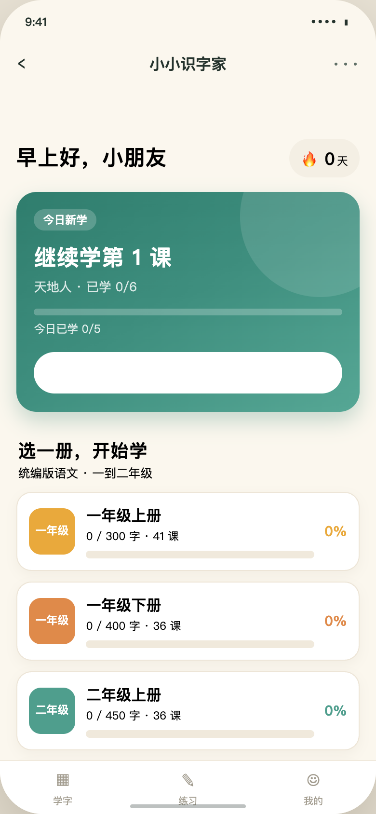
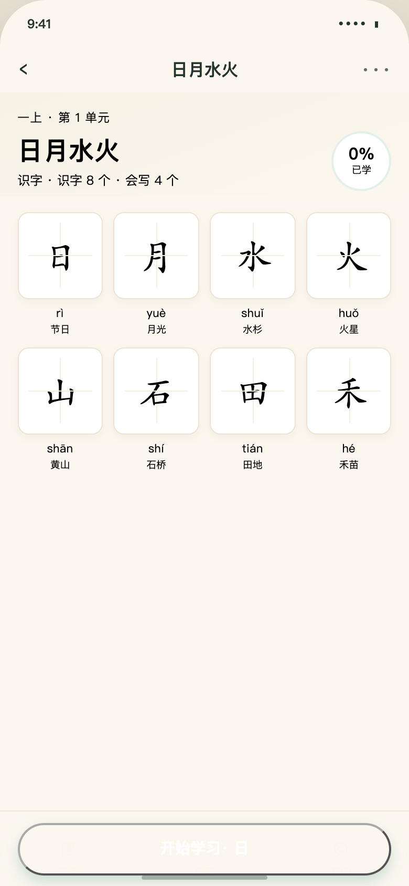
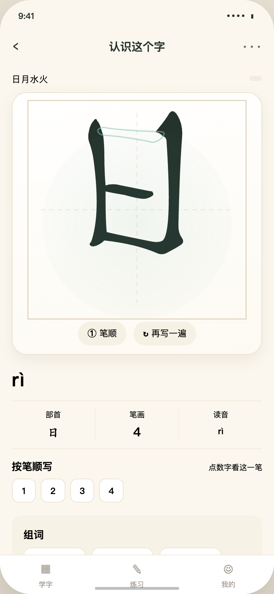
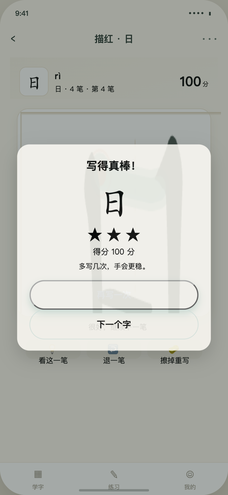
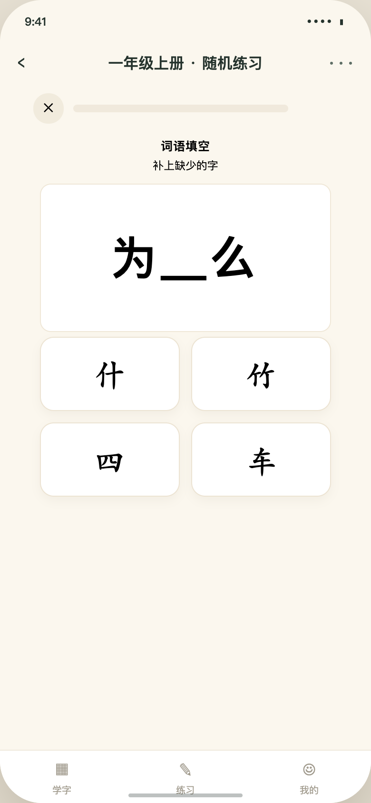

# 小小识字家

跟着统编版课本，一笔一笔把字写对。

面向小学一～四年级的汉字学习应用，提供**微信小程序**与**Android 原生**两种形态，
内容、算法、交互手感完全一致。

<p align="center">
  
  
  
  
  
</p>

---

## 立即使用

| | 微信小程序 | Android 原生 |
| --- | --- | --- |
| **用起来** | 用微信开发者工具导入本目录（见下方） | **[下载 APK](https://github.com/zhangxiang0316/hanzi/releases/latest)** · 3.9 MB · Android 7.0+ |
| **源码** | [`miniprogram/`](miniprogram/) | [`android/`](android/) |
| **环境** | 微信开发者工具，基础库 3.5.5+ | JDK 17 + Android SDK 36 |
| **测试** | 69 个（node:test） | 104 个（Robolectric + Compose UI Test） |

> APK 可直接安装使用，用仓库内的公开 debug 密钥签名，**不适合上架应用商店**。
> 正式发布请按 [android/keystore/README.md](android/keystore/README.md) 生成 release 密钥后重新构建。

---

## 它能做什么

| 功能 | 说明 |
| --- | --- |
| **跟课本学** | 统编版一上～四下，8 册 64 单元 276 课 **2600 个生字**（去重 2596 字，其中 1800 个要求会写） |
| **看笔顺** | 逐笔动画，可重播、单笔定格回放、显示笔顺序号，速度可调 |
| **描红评分** | 手指在田字格里写，**每一笔**即时判定；写错告诉你「起笔不对 / 写歪了 / 没写全」 |
| **练** | 5 种题型（看拼音选字、看字选拼音、词语填空、数笔画、找词语），干扰项取自同册 |
| **复习** | Leitner 间隔重复（0/1/2/4/7/15/30/60 天）+ 错题本，到期自动提醒 |
| **看进步** | 今日任务、连续天数、识字/掌握统计、徽章、近 7 天练习记录 |
| **零负担** | 无登录、无广告、无内购、无社交、**无网络请求**；数据只存本机 |

**刻意不做**：排行榜、付费、广告、虚拟宠物、每日签到奖励。

### 设计上的几个取舍

- **评分要「严而不苛刻」**：`ACCEPT=42` 分过关，正常描红（哪怕手抖 ±7px、首尾内缩 10%）
  都能通过，但倒着画、只划一段、偏离笔画会被退回重写。
- **不强制**：任何一笔写不过都可以重写，不弹窗打断、不扣分、不锁定。
- **离线优先**：笔顺数据全部打包进本地，没有一条网络请求，装上就能用。

---

## 快速开始

### 用微信开发者工具

```bash
git clone https://github.com/zhangxiang0316/hanzi.git
cd hanzi
```

1. 微信开发者工具 → 导入项目 → 选择本目录；
2. `project.config.json` 已配好 `miniprogramRoot: "miniprogram/"` 与
   `appid: "touristappid"`（游客模式即可预览，无需注册）；
3. 编译，首页即出。

> 换正式 AppID 只需改 `project.config.json` 的 `appid`。
> 笔顺页在分包里，进首页时用 `wx.loadSubpackage` 按「当前所选册次」只加载对应那一个包
> （`routes.preload(book)`）——不用 `app.json` 的 `preloadRule`，因为三个分包合计
> 超过微信「单页预载 ≤ 2 MB」的限制会报 80058。

### 直接装 Android 版

到 [**Releases**](https://github.com/zhangxiang0316/hanzi/releases/latest) 页面下载最新 APK，传到手机点击安装
（首次需允许「安装未知来源应用」）。或用 adb：

```bash
adb install -r xiaoxiao-hanzi-1.0.0.apk
```

当前版本 **[v1.0.0](https://github.com/zhangxiang0316/hanzi/releases/tag/v1.0.0)** ·
SHA-256 `1eae7014…b825b45c` · 仓库内也留了一份 [`android/dist/`](android/dist/)。

### 从源码构建 Android

```bash
# 1) 从小程序数据导出 Android assets（数据改动后需重跑）
node scripts/export-android.mjs

# 2) 构建（需要 JDK 17 + Android SDK）
export GRADLE_USER_HOME=$PWD/.tools/gradle-home
export ANDROID_HOME=$HOME/Library/Android/sdk
.tools/gradle-8.14.3/bin/gradle -p android :app:assembleRelease
# 产物：android/app/build/outputs/apk/release/app-release.apk

# 3) 跑测试（不需要模拟器，全在 JVM 上）
.tools/gradle-8.14.3/bin/gradle -p android :app:testDebugUnitTest
```

也可以直接用 Android Studio 打开 `android/` 目录。
详见 [Android 原生版](docs/06-Android原生版.md)。

### 用浏览器预览（无需开发者工具）

```bash
npm install          # 只装开发依赖（@napi-rs/canvas、puppeteer-core）
npm run preview      # http://127.0.0.1:8788
```

预览器会真实执行小程序页面 JS、解析 WXML，并实现 `wx.*` 的最小兼容层，
用于开发期快速看效果与自动化断言。

---

## 技术栈

| 层 | 小程序 | Android |
| --- | --- | --- |
| UI | WXML / WXSS | Jetpack Compose（BOM 2025.09.01） |
| 语言 | 原生 JS（CommonJS） | Kotlin 2.2.20 |
| 构建 | 微信开发者工具 | Gradle 8.14.3 + AGP 8.13.1 |
| 笔顺渲染 | Canvas 2D | `android.graphics.Canvas`（自定义 `HanziPainter`） |
| 存储 | `wx.setStorageSync` | SharedPreferences（JSON） |
| 网络 | 无 | 无 |

**零运行时依赖**。两边都没有引入第三方库：评分、出题、间隔重复、笔画解码
全部自己实现，`logic/` 与 `utils/` 是不依赖平台的纯逻辑，可以直接跑单测。

笔顺数据格式：`坐标量化(÷6) → 二进制 → base64`，
一个字的笔画路径与中线合计约 1 KB，2596 字共 2.4 MB。

---

## 命令

```bash
# ── 小程序 ──
npm run build:data     # 源数据 → 压缩笔顺二进制 + 目录/字库模块
npm run build:icons    # 生成 tabBar 图标（纯代码画 PNG）
npm run lint           # 静态检查（页面完整性/分包/WXSS 兼容/包体积/路由）
npm test               # 69 个单元测试
npm run render:check   # Node Canvas 渲染自检（像素断言）
npm run preview        # 浏览器预览 http://127.0.0.1:8788
npm run preview:shots  # 34 张截图 + 27 条交互断言（需本机 Chrome）
npm run check          # 以上全部：构建 + 静态检查 + 单测 + 渲染自检
npm run fetch:strokes  # 重新抓取笔顺源数据（一般不需要）

# ── Android ──
node scripts/export-android.mjs   # 合并 8 册笔顺 → android assets
```

`npm run check` 当前输出：

```
✓ 数据构建完成   字库 2596 字；主包 713 KB，分包 1446 + 512 + 525 KB
✓ 静态检查通过：15 个页面，45 个 JS，16 个 WXSS，主包 713 KB（总体积 3197 KB）
# tests 69   # pass 69   # fail 0
✓ 渲染自检通过：16 个字、笔顺递增、动画终态一致
```

---

## 目录结构

```
hanzi/
├── miniprogram/                 小程序源码（miniprogramRoot）
│   ├── data/                    主包数据：catalog.js（目录）meta.js（字属性）
│   ├── utils/                   catalog / progress / srs / plan / quiz / trace …
│   ├── pages/                   首页、单元、课文、练习、答题、结果、我的、错题本、关于
│   ├── packageStrokes/          分包：一二年级笔顺数据 + 字详情 + 描红
│   ├── packageStrokes3/         分包：三年级（同上）
│   ├── packageStrokes4/         分包：四年级（同上）
│   └── LICENSE-ARPHIC.txt       笔顺数据许可证（随包分发）
│
├── android/                     Kotlin + Compose 原生版
│   ├── app/src/main/
│   │   ├── assets/data/         catalog.json / meta.json / strokes.json（导出产物）
│   │   ├── java/com/xiaoxiao/hanzi/
│   │   │   ├── data/            Models / Repo / StrokeCodec
│   │   │   ├── logic/           Srs / Trace / Quiz / Plan / Progress / Store
│   │   │   └── ui/              Theme / Components / HanziPainter / Nav / 11 个页面
│   │   └── res/
│   ├── app/src/test/            104 个测试（Robolectric）
│   └── dist/                    发布的 APK
│
├── content/source/              原始数据（不打包，可复现构建）
├── scripts/                     build-data / gen-icons / lint / render-check / preview / export-android
├── tests/                       node:test 单元测试
├── preview/                     浏览器预览器（实现 wx.* 兼容层）
└── docs/                        规划、技术方案、合规、测试、Android 版
```

---

## 测试

两套测试独立运行，期望值同源——Android 侧的断言直接取自小程序现有测试，
保证两种实现不会悄悄跑偏。

| 套件 | 数量 | 覆盖 |
| --- | --- | --- |
| 小程序 `npm test` | 69 | 数据完整性、路由与分包映射、评分、出题、SRS、图标 |
| 小程序 `npm run render:check` | — | 真实 Canvas 渲染：笔画像素递增、终态一致 |
| 小程序 `npm run preview:shots` | 27 条断言 | 完整交互流程 + 视觉回归（34 张截图） |
| Android `RepoTest` | 13 | 教材数据完整性、笔画数、多音字、跨册重复 |
| Android `LogicTest` | 24 | SRS、描红评分、出题器（与小程序同种子等价） |
| Android `AppUiTest` | 22 | 11 个页面渲染、按钮可点、文案正确 |
| Android `LayoutTest` | 9 | 几何断言：按钮满宽居中、芯片网格、tab 均分 |
| Android `CanvasRenderTest` | 5 | 像素级：汉字真画出来了、没有上下倒置、配色正确 |
| Android `E2ETest` | 5 | 真实手势走完描红评分与存档 |
| Android `WritePageTest` | 7 | 描红状态机：最后一笔实心、抖动也能过、写错有原因 |
| Android `ScreenshotTest` + `FullPageShotTest` | 19 | 页面截图（含超长视口整页） |

Android 测试全部跑在 JVM 上（Robolectric + Compose UI Test），**不需要模拟器**。

---

## 体积

| 包 | 大小 | 内容 |
| --- | --- | --- |
| 小程序主包 | **713 KB** / 2 MB | 9 个页面 + 目录 + 字库 + 笔顺渲染引擎 |
| 分包 `packageStrokes` | **1446 KB** / 2 MB | 一、二年级笔顺数据 + 字详情 + 描红 |
| 分包 `packageStrokes3` | **512 KB** / 2 MB | 三年级（同上） |
| 分包 `packageStrokes4` | **525 KB** / 2 MB | 四年级（同上） |

小程序对主包和**单个**分包各有 2 MB 上限，所以笔顺数据按年级拆成三个分包：
主包只放渲染引擎和页面逻辑，各分包只放自己年级的二进制数据。
新增年级 = 加一个数据目录 + 一条 `routes.PACK_OF_BOOK` 映射。

预载用代码而非 `preloadRule`：后者是静态配置，无法按用户当前册次区分，
把三个包一起预载会超过「单页 ≤ 2 MB」的限制（错误码 80058）。

| Android | 大小 |
| --- | --- |
| release APK | **3.9 MB** |
| release AAB | **4.2 MB** |
| 其中笔顺数据（assets） | 2.4 MB（单文件，无 2 MB 限制） |

原生侧没有分包体积限制，8 册笔顺合成一个 `strokes.json`，
也就不存在小程序那种「预载包超限」的问题。

---

## 数据来源

- **字表 / 拼音 / 部首 / 组词**：依据统编版（部编版）小学语文教材整理，
  经 [fsiceangel/zishi](https://github.com/fsiceangel/zishi) 汇总。
- **笔顺**：[Make Me a Hanzi](https://github.com/skishore/makemeahanzi)，
  字形来源于 Arphic 字体，遵循 **Arphic Public License**
  （[许可证全文](miniprogram/LICENSE-ARPHIC.txt)）。

本项目与教材出版方无隶属关系，内容仅用于识字练习。
详见 [内容版权与合规](docs/03-内容版权与合规.md)。

---

## 隐私

不收集任何个人信息，无登录、**无网络请求**。

| | 存在哪 | 怎么清除 |
| --- | --- | --- |
| 小程序 | 本机 `wx.storage` | 清除小程序缓存 |
| Android | 应用私有目录（SharedPreferences） | 系统设置里清除应用数据，或卸载 |

两端数据格式不同，**不互通、不迁移**，各自独立。

---

## 常见问题

**Q：小程序提示 `preloadRule ... source size exceed max limit 2MB`（80058）？**
微信限制「单个页面预加载的分包总量 ≤ 2 MB」。本项目**不使用 `app.json` 的 `preloadRule`**
（它是静态配置，写死预载哪些包，三个分包合计 2483 KB 必然超标），
改为在代码里用 `wx.loadSubpackage` 只加载用户当前那册所属的包（`routes.preload(book)`）。
如果新增年级后复现这个报错，检查是否有人把 `preloadRule` 加回了 `app.json`。

**Q：改了 `.wxss` / `.wxml` / 数据看不到效果？**
在开发者工具里重新编译。改了 `app.json` 的分包结构需要**完整重新编译**（而不只是刷新）。

**Q：Android 描红写最后一笔没反应？**
已在 1.0.0 修复（最后一笔的完成状态没同步到绘制）。若仍是旧版本请重新安装。

**Q：为什么描红底字和笔画有时候看着有点错位？**
底字用的是系统楷体字形，评分用的是笔顺数据的中线，两者本来就有细微差异。
这是为保留字体的笔锋质感做的取舍，不影响判分（容差按画布边长取比例）。

**Q：能加到三年级以上吗？**
数据里已经是四年级了（8 册）。再加年级 = 加数据 + 一条分包映射，代码不用改。

**Q：iOS 版？**
没有。小程序在 iOS 微信里可以直接用；原生版目前只有 Android。

---

## 文档

| 文档 | 内容 |
| --- | --- |
| [产品规划](docs/01-产品规划.md) | 用户与场景、学习闭环、信息架构、页面线框、分期与指标 |
| [技术方案](docs/02-技术方案.md) | 选型、数据管线、二进制格式、渲染引擎、评分算法、SRS、体积账本 |
| [内容版权与合规](docs/03-内容版权与合规.md) | 数据来源、Arphic 许可证义务、上架合规、免责文案 |
| [测试与验收](docs/04-测试与验收.md) | 五层验证怎么做、怎么跑、覆盖了什么、没覆盖什么 |
| [朗读功能方案](docs/05-朗读功能方案.md) | 插件选型、体积账本、多音字策略、接口设计（待评审，未实现） |
| [Android 原生版](docs/06-Android原生版.md) | 迁移动机、工程结构、关键实现、构建运行、发布清单 |

---

## 版本

| 版本 | 内容 |
| --- | --- |
| **1.0.0** | Android 原生版首发；小程序支持一～四年级；描红最后一笔修复 |

后续计划：接入朗读（`TextToSpeech`）、深色模式、平板适配。

---

## License

- **程序代码**：可自由用于学习与教学。
- **笔顺数据**：Arphic Public License（见 [miniprogram/LICENSE-ARPHIC.txt](miniprogram/LICENSE-ARPHIC.txt)），
  修改后的数据须以相同条款提供。
