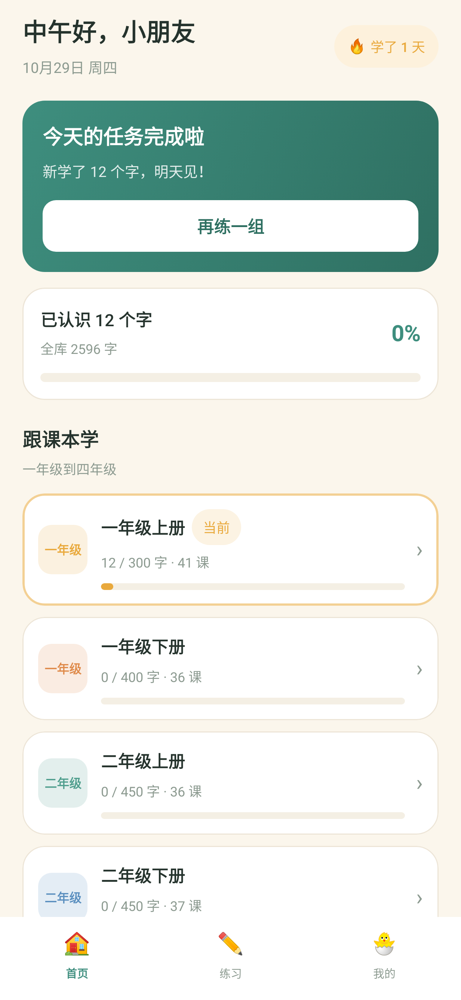
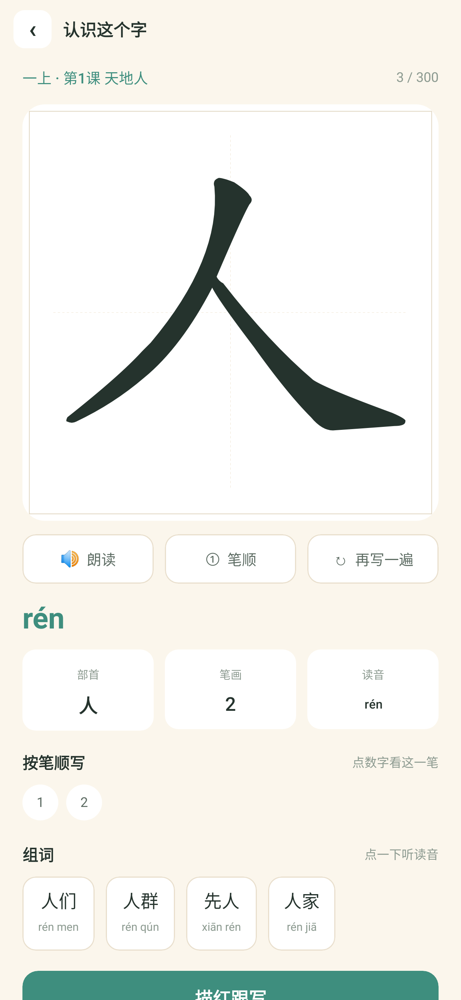
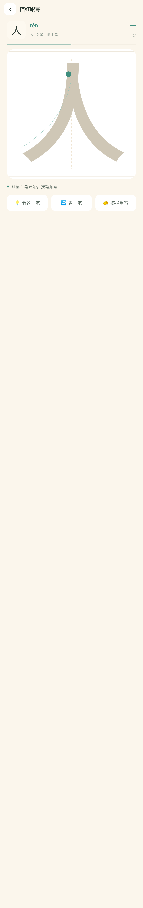
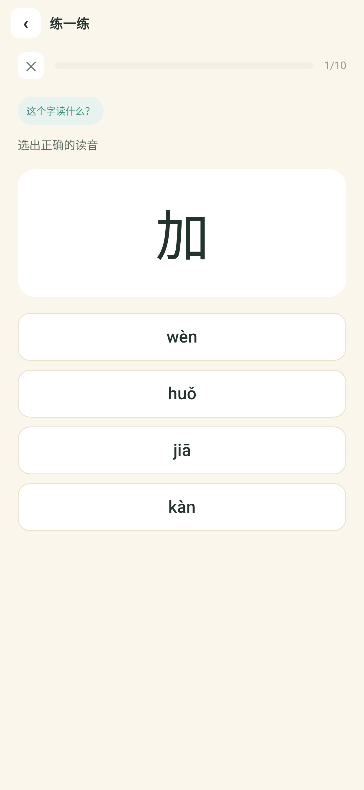
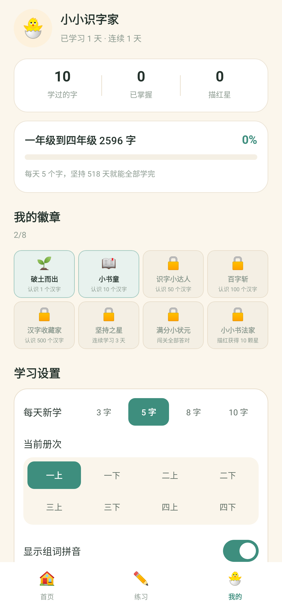

# Android 原生版

把小程序的全部功能移植成 Kotlin + Jetpack Compose 原生应用。
内容、算法、交互手感与小程序保持一致；工程结构按 Android 的最佳实践重排。

<p align="center">
  
  
  
  
  
</p>

---

## 1. 为什么搬到原生

小程序版本已经能跑，但有三个绕不过去的限制：

| 限制 | 影响 |
| --- | --- |
| 主包 + 单分包各 2MB | 笔顺数据被迫切成 4 个包，按册懒加载。四年级塞进去时已经逼到 1446KB / 2048KB |
| 无本地 TTS / 音频 | 「读」这个功能在微信里只能靠预生成音频 + 分包下载，方案复杂（见 `05-朗读功能方案.md`） |
| 交互受 WebView 限制 | 描红需要 `catchtouchmove` 抢手势，滚动与书写容易互相干扰 |

原生侧这三个限制全部消失：assets 里放 3MB 数据毫无压力，`TextToSpeech` 直接可用，
PointerInput 可以精确控制手势消费。

## 2. 体积对比

| | 小程序 | Android |
| --- | --- | --- |
| 笔顺数据 | 4 个分包，1446 + 512 + 525 KB | 单个 `strokes.json` 2.4 MB |
| 加载方式 | 按册预载，失败要重试 | 启动时一次解析，常驻内存 |
| 数据文件数 | 8 个 `strokes-*.js` | 1 个 JSON |
| 总安装包 | ~2.6 MB（不含微信本体） | release APK **3.9 MB**，AAB **4.2 MB** |

## 3. 工程结构

```
android/
├── settings.gradle.kts          # 仓库配置、模块声明
├── build.gradle.kts             # 插件版本（AGP 8.13.1 / Kotlin 2.2.20）
├── gradle.properties            # 内存、in-process 编译（沙箱/CI 需要）
├── local.properties             # sdk.dir（不进仓库）
├── keystore/debug.keystore      # 工程内 debug 签名（不进仓库）
└── app/
    ├── build.gradle.kts
    └── src/
        ├── main/
        │   ├── AndroidManifest.xml
        │   ├── assets/data/     # catalog.json / meta.json / strokes.json
        │   ├── res/             # 字符串、颜色、主题、矢量图标
        │   └── java/com/xiaoxiao/hanzi/
        │       ├── MainActivity.kt
        │       ├── data/        # 数据层
        │       │   ├── Models.kt       册 / 单元 / 课 / 字元数据
        │       │   ├── Repo.kt         目录与笔顺的统一查询入口
        │       │   └── StrokeCodec.kt  base64 笔顺解码
        │       ├── logic/       # 纯逻辑（无 Android 依赖，可直接单测）
        │       │   ├── Srs.kt          Leitner 间隔复习
        │       │   ├── Trace.kt        描红评分
        │       │   ├── Quiz.kt         出题器
        │       │   ├── Plan.kt         今日任务 / 继续学习
        │       │   ├── Progress.kt     进度、错题、徽章、统计
        │       │   ├── Store.kt        SharedPreferences 封装
        │       │   └── DayUtil.kt      自然日 / 问候语
        │       └── ui/
        │           ├── Theme.kt        设计 token（对应 app.wxss 的 CSS 变量）
        │           ├── Components.kt   卡片 / 按钮 / 进度条 / 空状态
        │           ├── HanziPainter.kt 汉字画布渲染（对应 hanzi-canvas.js）
        │           ├── Nav.kt          返回栈
        │           ├── AppState.kt     全局状态
        │           ├── Root.kt         外壳：状态栏 / 返回栏 / 底部 tab
        │           └── pages/          11 个页面
        └── test/java/com/xiaoxiao/hanzi/   # 91 个测试
```

### 与小程序的文件对应关系

| 小程序 | Android | 说明 |
| --- | --- | --- |
| `utils/hanzi-canvas.js` | `ui/HanziPainter.kt` | 画布 API 不同，绘制顺序与参数一致 |
| `utils/trace.js` | `logic/Trace.kt` | 逐行对应，权重常量相同 |
| `utils/srs.js` | `logic/Srs.kt` | 间隔表相同 |
| `utils/quiz.js` | `logic/Quiz.kt` | `mulberry32` 同种子出同一套题 |
| `utils/progress.js` | `logic/Progress.kt` | 存储从 `wx.setStorageSync` 换成 SharedPreferences |
| 9 个主包页 + 4 个分包页 | 11 个 `@Composable` | 分包页面是同一逻辑的薄壳，合并后少 4 个 |

## 4. 关键实现说明

### 4.1 笔顺数据

`scripts/export-android.mjs` 把 8 本书的 `strokes-*.js` 合并成一个 `strokes.json`，
并校验「每个字都有笔顺、没有多余的字」。数据集：

- 2596 个汉字（去重后）
- 276 课、64 个单元、8 册
- 每个字的笔画路径 + 中线（中线下标与笔画序号一一对应）

解码在 `StrokeCodec`：`u8 version` + `u8 strokeCount` + 每笔 `u16 长度 + 操作码序列`，
坐标 `×6` 还原，y 在构建期已翻转为屏幕坐标。

### 4.2 画布坐标

小程序里画布坐标依赖 `ctx.scale(dpr, dpr)` 与 CSS 尺寸，出现过「上下倒置」和
「字号变大」两个 bug。Android 侧统一成一套几何：

```kotlin
// 田字格：0..1024 线性映射，四周留 3.5% 边距
px(v) = pad + v / 1024 * (box - 2*pad)
```

描红页更进一步：把 `box / ox / oy` 放进一个 `Geom` 对象，**由 `onSizeChanged`
在布局阶段填充**，绘制与评分共用同一份。这样「画在哪」和「按哪判分」不可能错位。

> 踩过的坑：最初把几何写在 Canvas 的绘制 lambda 里，依赖「先画后摸」的顺序。
> 单测环境下没有绘制过程，`box` 恒为 0，评分静默失效。改成布局阶段后问题消失。

### 4.3 描红的状态机

描红页有三个状态量：`strokeIndex`（当前第几笔）、`scores`（各笔得分）、`done`（写完了）。
它们之间的推进关系是本模块最容易出错的地方，踩过两个 bug：

**bug 1：最后一笔写不上。**
通过一笔的代码是 `strokeIndex += 1`，但写完最后一笔时走的是 `finish()` 分支，
`strokeIndex` 不再自增，停在 `count - 1`。而绘制用的已完成笔数是 `minOf(strokeIndex, count)`，
于是最后一笔永远画不出来，一直显示成虚线提示——看起来就是"最后一笔没写上去"。

修法是让绘制显式判断 `done`：

```kotlin
completed = if (done) strokes.count else minOf(strokeIndex, strokes.count)
if (!done && strokeIndex < strokes.count) { /* 画当前笔的虚线提示 */ }
```

**bug 2：退一笔会跳过最后一笔。** 同一个原因——完成后 `strokeIndex` 停在最后一笔上，
退一笔时再 `-1` 就直接跳过了它。所以 `done` 状态下退回只清 `done`，不动 `strokeIndex`。

这两个 bug 的共同点是：`done` 这个状态与 `strokeIndex` 的语义重叠了。
更干净的做法是用 `scores.size` 作为已完成笔数的唯一来源（它天然等于已通过笔数），
`strokeIndex` 只是 `scores.size` 的派生值。重构留到下次改动这个页面时做，
当前修法有测试兜底。

**写错时的反馈**：小程序用 `reasonText()` 把评分原因翻成中文提示。
Android 版最初直接静默清空笔迹，孩子会以为"写了没反应"——而点画（"点"这个笔画）
经常是最后一笔，于是又表现为"最后一笔写不上"。现在补齐了四档提示文案，
与小程序 `utils/write-page.js` 一字不差。

### 4.4 手势

描红不用 `detectDragGestures` —— 它要等超过触摸滑动阈值才回调 `onDragStart`，
**笔画开头的几毫米会被吞掉**（小程序用 `bindtouchstart` 记录起点，没有这个损失）。
改用 `awaitEachGesture` 从按下点开始采样，并立即 `consume()`，
避免外层 `verticalScroll` 把「写字」误判成「滚页」。

### 4.5 状态管理

没有引入 ViewModel / Hilt / Navigation-Compose：

- 全局状态只有一份（进度、设置、当前册），`AppState` 持有即可
- 返回栈是 11 个目的地的线性栈，一个 `List` + 三个方法够用
- 没有深链接、没有跨栈共享状态的需求

代价是 `AppState` 需要在 Activity 里创建；若将来要跨进程或做多窗口，
再引入 ViewModel 也只是把 `AppState` 包一层。

### 4.6 数据迁移

小程序与 Android 的存储格式不同（`wx.setStorageSync` 的 JSON vs SharedPreferences），
目前**不做自动迁移**。两边数据独立，互不影响。

## 5. 构建与运行

### 环境

- JDK 17
- Android SDK（compileSdk 36）
- 无需 Android Studio，命令行可完整构建

### 命令

```bash
# 1) 导出数据（小程序数据改动后需重跑）
node scripts/export-android.mjs

# 2) 构建 debug APK
export GRADLE_USER_HOME=$PWD/.tools/gradle-home
export ANDROID_HOME=$HOME/Library/Android/sdk
.tools/gradle-8.14.3/bin/gradle -p android :app:assembleDebug
# 产物：android/app/build/outputs/apk/debug/app-debug.apk（20 MB，未混淆）

# 2b) 构建发布包（混淆 + 资源压缩）
.tools/gradle-8.14.3/bin/gradle -p android :app:assembleRelease :app:bundleRelease
# 产物：app-release.apk（3.9 MB）/ app-release.aab（4.2 MB）

# 3) 跑测试
.tools/gradle-8.14.3/bin/gradle -p android :app:testDebugUnitTest

# 4) 只跑某一类
.tools/gradle-8.14.3/bin/gradle -p android :app:testDebugUnitTest \
  --tests "com.xiaoxiao.hanzi.LayoutTest"
```

### 用 Android Studio

直接用 Android Studio 打开 `android/` 目录即可。`local.properties` 里需要写本机
SDK 路径（已 gitignore）。

## 6. 测试策略

模拟器在本机沙箱环境里起不来（AVD 快照锁文件在沙箱外，无法清理），
所以采用 **Robolectric + Compose UI Test** 在 JVM 上跑真实渲染与布局。

| 测试类 | 数量 | 覆盖 |
| --- | --- | --- |
| `RepoTest` | 13 | 教材数据完整性：册数、字数、笔画数、多音字、跨册重复 |
| `LogicTest` | 24 | SRS、描红评分、出题器（含与小程序同种子的等价性） |
| `AppUiTest` | 22 | 11 个页面能渲染、按钮能点、文案正确 |
| `LayoutTest` | 15 | 几何断言：按钮满宽居中、首页册次 2×4 与徽章 4×2、底栏高度与点击区、工具条三芯片 |
| `CanvasRenderTest` | 5 | 像素级：汉字真画出来了、没有上下倒置、配色正确 |
| `E2ETest` | 5 | 真实手势走完描红评分 + 存档 |
| `ScreenshotTest` | 13 | 13 张页面截图，输出到 `build/screenshots/` |
| `FullPageShotTest` | 6 | 超长视口整页截图，用来看首屏以下的内容 |
| `WritePageTest` | 7 | 描红全流程：最后一笔实心、抖动也能过、写错有原因、点一下有提示 |

**合计 133 个测试，全绿。**

### 写法上的两个坑

1. **`Thread.sleep` 不会推进 Compose 动画时钟。** 笔顺动画用 `delay` 驱动，
   测试里必须 `compose.mainClock.advanceTimeBy(...)`，且**顺序**是「先等首帧、
   再拨时钟」——首帧没跑，`LaunchedEffect` 还没启动，拨过去的时间等于白拨。
2. **`getBoundsInRoot()` 返回的是裁剪到可视区后的矩形。** 页面比屏幕长时，
   下半屏节点会得到 0 宽或被截断的高度。几何断言要用超长视口
   （`w411dp-h2400dp-xxhdpi`）。

### 视觉回归

`ScreenshotTest` 会把每个页面渲染成 PNG。因为 Robolectric 自带字体没有中文，
需要把系统中文字体放进 `.tools/robolectric-fonts/`，
并通过 `-Drobolectric.fonts=<dir>` 指给测试 JVM（`build.gradle.kts` 里已配置）。

直接用 `ascii-shot.mjs` 或看图工具检查
`android/app/build/screenshots/*.png` 即可。

## 7. 已知差异与后续

### 与小程序的行为差异

| 项 | 小程序 | Android |
| --- | --- | --- |
| 返回入口 | 每页自绘返回按钮 + 微信胶囊避让 | 系统返回键 + 顶部返回栏 |
| tab 切换 | `wx.switchTab` | 同样的返回栈语义 |
| 数据存储 | `wx.setStorageSync` | SharedPreferences（`commit()` 同步落盘） |
| 升级 | 无需安装 | 需签名、发版 |

### 还没做的

- **朗读**：`TextToSpeech` 可直连，方案已写在 `05-朗读功能方案.md`，代码未接入
- **release 签名**：工程里只有 debug 密钥，正式上架需按
  `android/keystore/README.md` 生成 release 密钥（构建脚本已支持自动读取）
- **深色模式**：只做了浅色主题（与小程序一致）
- **平板 / 横屏**：布局按手机竖屏设计，未做适配
- **真机验证**：受沙箱限制只在 Robolectric 上验证过渲染与手势，
  建议上架前在真机上过一遍描红手感

### 发布检查清单

- [ ] 生成 release 密钥并备份（`android/keystore/README.md`）
- [ ] `apksigner verify --print-certs` 确认签名不是 `CN=Android Debug`
- [ ] 改 `versionCode` / `versionName`
- [ ] 真机跑描红：起笔、连笔、写错重来
- [ ] 真机跑长页面滚动：课文页 20+ 生字、错题本
- [ ] 确认应用名称、图标、隐私政策链接
