# 小小识字家 · iPad 版

面向小学一二年级的识字 App，SwiftUI 原生实现，**以 iPad 大屏为主**，不做 iPhone 专属紧凑布局。

数据与小程序、Android 版共用同一份（统编版 8 册、2600 生字、276 课），三端的
学习记录、出题、判分逻辑逐条对齐。

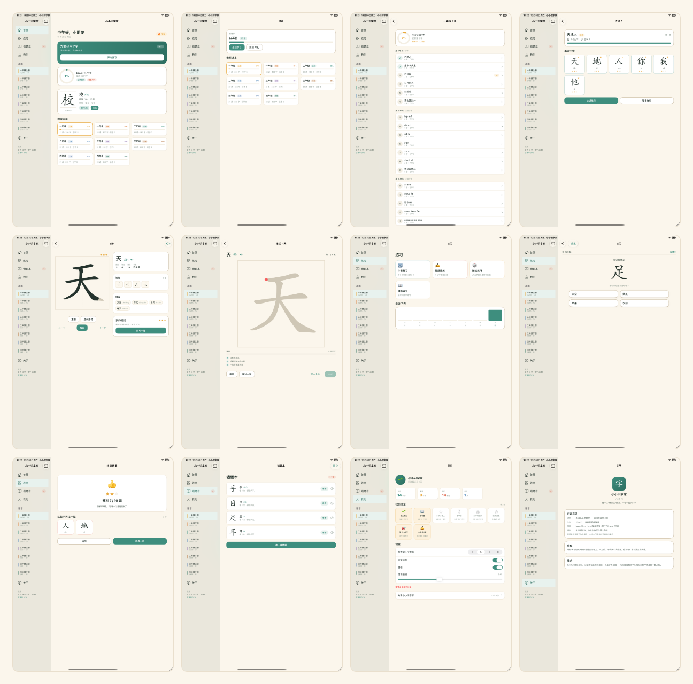

## 功能

- **跟课本学** —— 按统编版 8 册 / 64 单元 / 276 课组织，生字带拼音、组词、笔顺
- **笔顺动画** —— 逐笔播放，可暂停、可停在任意一笔
- **描红** —— 手指照着底字写，逐笔判定、打分、给星；写错的笔会被指出
- **间隔复习** —— 8 个箱位的 SRS，按掌握度安排今天该复习哪些字
- **练习与答题** —— 看拼音选字 / 看字选拼音 / 组词，每次 10 题
- **错题本** —— 自动收集答错的字，可单独重练
- **学习统计** —— 连续天数、累计识字量、掌握度、描红星数、徽章墙
- **朗读** —— 系统中文语音，语速可调
- **无网络** —— 全部离线，不收集任何数据，学习记录只存在本机

## 界面

12 个页面。`Pages/` 下 11 个文件，课本页（`CoursesPageView`）写在 `App/RootView.swift` 里。

| | | |
|:---:|:---:|:---:|
| 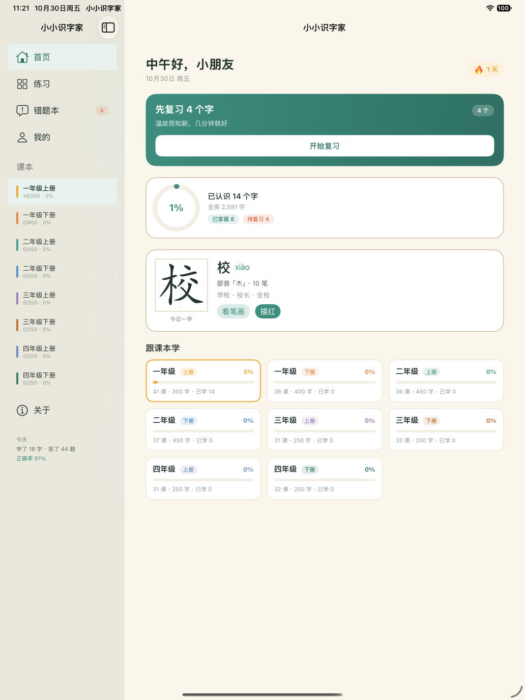<br>**首页** 今日任务 + 课本入口 | 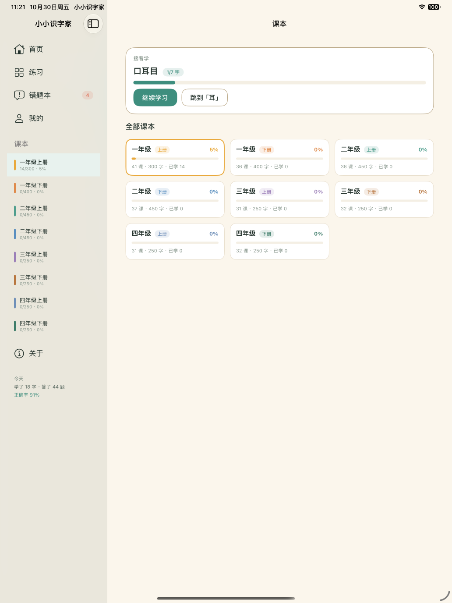<br>**课本** 8 册进度 | 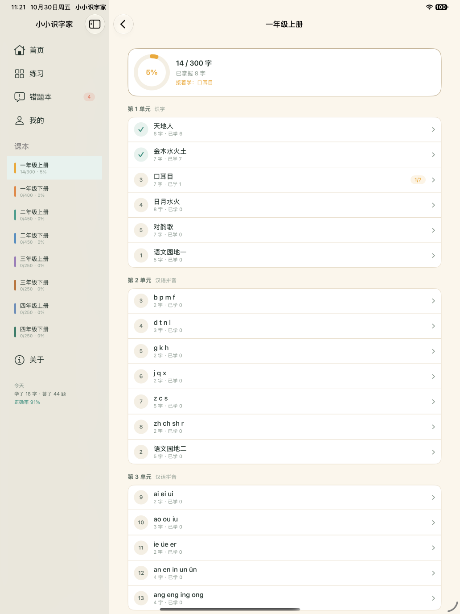<br>**单元** 课文列表 |
| 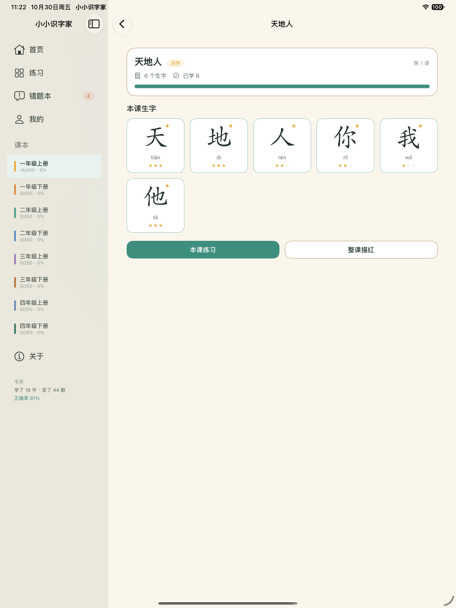<br>**课文** 本课生字 | 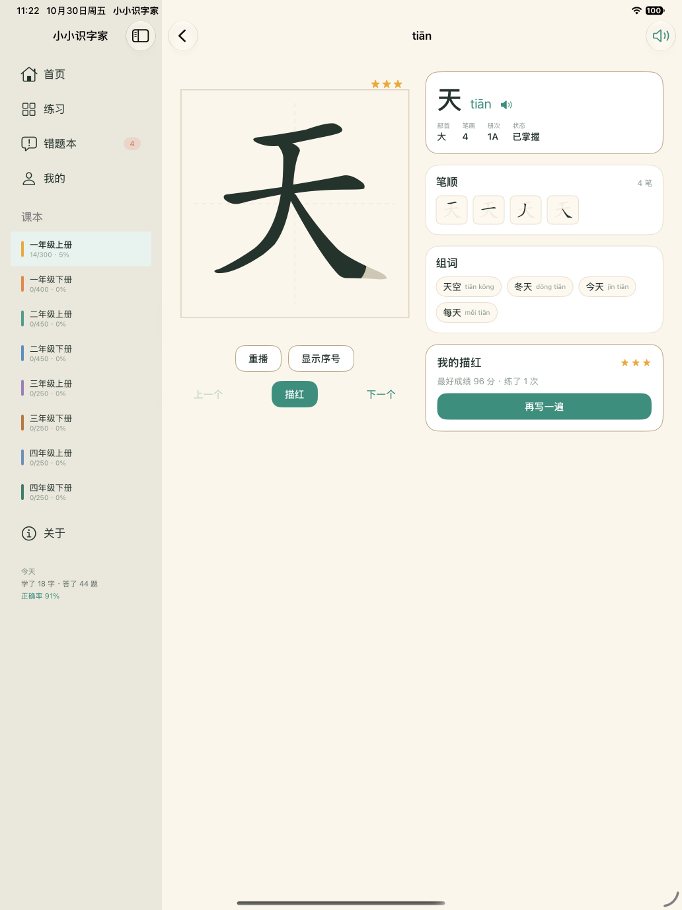<br>**生字详情** 笔顺 / 组词 / 掌握度 | 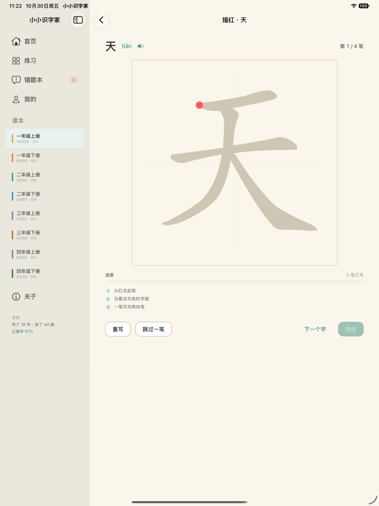<br>**描红** 逐笔判定 |
| 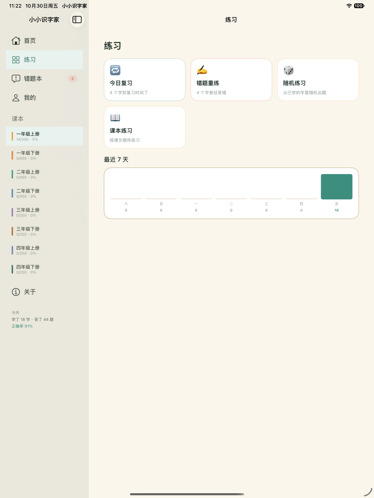<br>**练习** 今日复习 / 自由选书 | 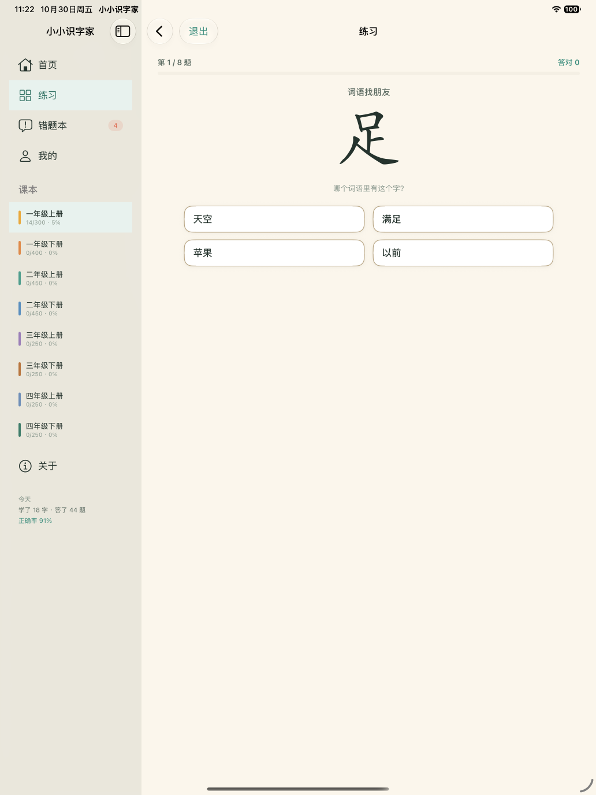<br>**答题** 四选一 | 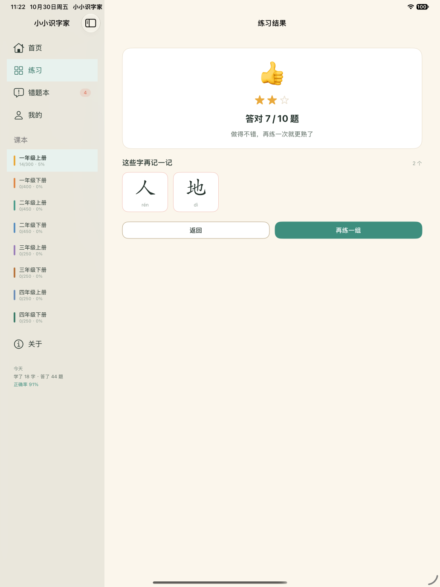<br>**结果** 星级与本轮错字 |
| 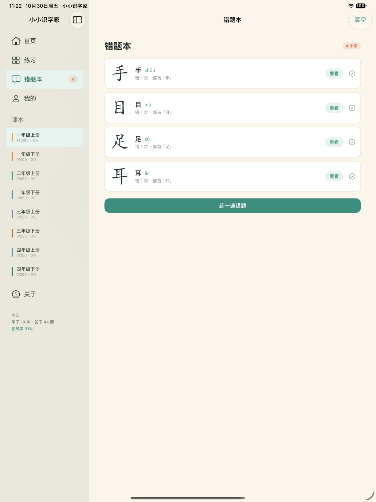<br>**错题本** 答错的字 | 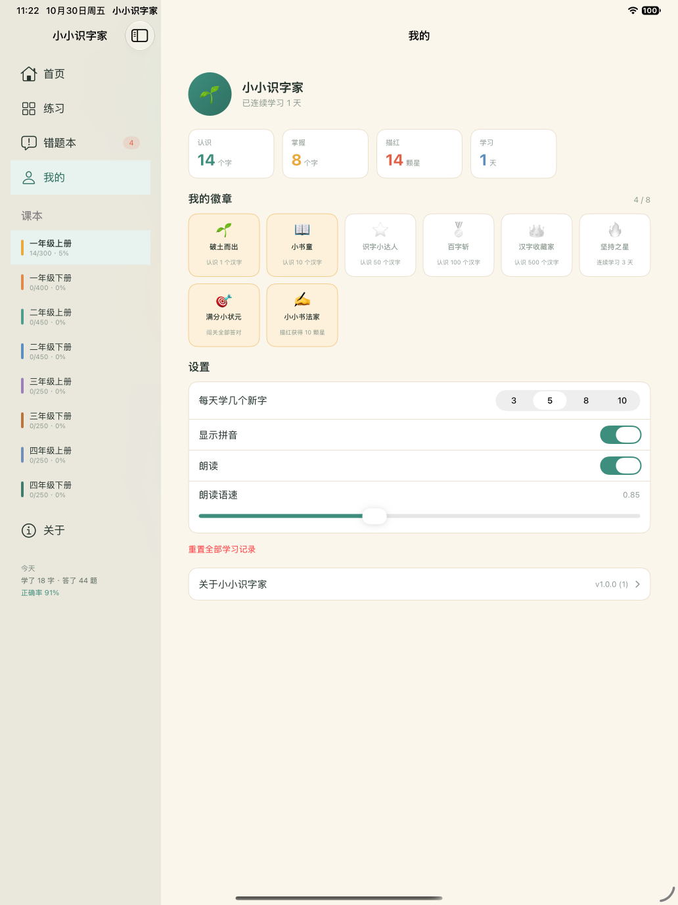<br>**我的** 统计 / 徽章 / 设置 | 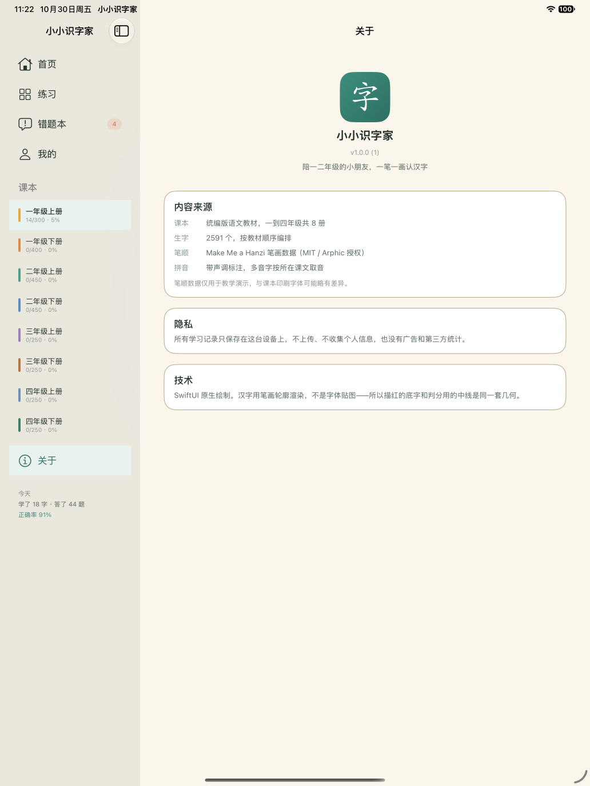<br>**关于** |

导航用 `NavigationSplitView` 侧边栏，不用底部 tab：Android 用底部三 tab 是因为手机屏幕窄、
列不出更多入口；iPad 上底部导航离手远，横屏又有大量横向空间，侧边栏更自然。
侧边栏同时承担课本选择，8 册直接列出来，比藏在首页宫格里少一次跳转。

## 构建

```bash
cd ios
xcodebuild -project HanziPad.xcodeproj -scheme HanziPad \
  -destination 'platform=iOS Simulator,name=iPad Pro 13-inch (M5)' \
  -derivedDataPath .build -configuration Debug \
  OTHER_SWIFT_FLAGS="-disable-sandbox" build
```

两个和代码无关、但必须加的参数：

- `-derivedDataPath .build`：默认的 `~/Library/Developer/Xcode/DerivedData` 在受限沙箱下不可写
- `OTHER_SWIFT_FLAGS="-disable-sandbox"`：Swift 编译器会用 `sandbox-exec` 包裹宏插件进程，
  在已经受限的环境里会报 `sandbox_apply: Operation not permitted`，导致 `@State`、`#Preview`
  等 SwiftUI 宏全部「could not be found」。在正常的开发机上这两个参数都不需要。

仅 iPad（`TARGETED_DEVICE_FAMILY = 2`），最低 iOS 17，版本 1.0.0。

## 测试

数据层与逻辑层零 UIKit 依赖，用 SPM 在 macOS 上原生跑，不需要模拟器：

```bash
cd ios && swift test --disable-sandbox
```

**145 个测试**：数据 28 / 逻辑 41 / 绘制 21 / 描红 33 / 布局 11 / 朗读 4 / 设置 7。

`--disable-sandbox` 只在受限环境需要，正常开发机去掉即可。

Xcode 的 XCTest target 在沙箱里跑不起来（`IDEPseudoTerminalDomain` 伪终端错误），
所以逻辑测试全部走 SPM。界面层用模拟器截图核对，见下。

## 工程结构

```
HanziPad/
  App/        入口、AppState（导航/路由）、RootView（侧边栏 + 课本页）
  Data/       Arcade 模型、数据加载、笔顺解码
  Logic/      SRS、学习计划、出题、描红判分、进度存储（纯逻辑，可单测）
  UI/         画布、绘制、组件、主题、自适应规则
  Platform/   朗读（AVSpeechSynthesizer）
  Pages/      11 个页面
  Resources/  catalog.json / meta.json / strokes.json（与 Android 共用同一份）
Checks/       SPM 测试
Tools/
  render-probe.swift   离线渲染探针，不经过模拟器直接出图
docs/screenshots/      界面截图
```

### 怎么重新生成截图

调试版 App 支持几个启动参数（全部包在 `#if DEBUG` 里，Release 包不含），
用来跳过点击直接进到某个页面：

```bash
xcrun simctl launch booted com.xiaoxiao.hanzi \
  -seedDemo -startSection courses -startRoute char:天:1a-s1
xcrun simctl io booted screenshot page.png
```

| 参数 | 作用 |
| --- | --- |
| `-startSection home\|courses\|practice\|wrong\|profile\|about` | 直接切到某个侧边栏分区 |
| `-startRoute book:1a` / `lesson:1a-s1` / `char:天:1a-s1` / `write:天` / `quiz:review:1a` / `result:7:10` | 直接推入某个详情页 |
| `-seedDemo` | 造一批学习记录（会先 `resetAll`，保证可重复） |
| `-setPinyin 0\|1` | 开关组词注音，用于对比验证设置是否生效 |
| `-reportBundle` | 导出运行时的本地化配置 |
| `-selfTestSpeech` | 设备上真调一次朗读，验证音频会话能配起来 |

`-seedDemo` 开头先 `resetAll` 是有原因的：进度是落盘的，不重置的话每次启动都在上次
数据上叠加，同一个参数两次截图画面都不一样，没法做像素对比。修完之后两次同参数截图
**逐像素相同（差异 0）**。

---

# 实现记录

按里程碑记录判断依据和踩过的坑。都写在「所以为什么这么做」上，
而不是「做了哪些文件」——后者看目录就行。

## M0 工程骨架 + 绘制可行性验证（2026-10-30）

在写一行界面代码之前先验证了地基，结论如下。

### 1. 笔顺轮廓在 iOS 上能正确渲染

`strokes.json` 是 Base64 编码的二进制路径数据。**移植时踩到一个坑**：
`StrokeCodec.kt` 里注释写「坐标 = 原坐标 / SCALE(6)」，我照着写成了解码时**除以** 6，
结果每个字的包围盒只有 20 多像素，看起来像"数据坏了"。

实际 Android 的 `private fun c(v: Byte) = (v and 0xFF) * SCALE` 是**乘以** 6——
注释描述的是构建期的编码方向（除以 6 才能塞进一个字节），解码要乘回来。修正后正常。

这个 bug 值得记下来：它不会报错、不会崩溃，只会让字变小到几乎看不见，
如果等到 M5 做界面时才发现，排查成本会高得多。

### 2. 方向正确，没有翻转

用互为镜像的「上」「下」做交叉验证，比较笔画与系统字形的墨迹分布：

| 字 | 笔画质心 y | 字形质心 y | 笔画上半墨迹 | 字形上半墨迹 |
| --- | --- | --- | --- | --- |
| 上 | 0.567 | 0.626 | 40% | 39% |
| 下 | 0.372 | 0.354 | 77% | 75% |

两个字的方向相反且各自与字形高度吻合，确认 y 轴处理正确。

### 3. 底字要用笔画轮廓，不能用系统字体

「天」的笔画轮廓填充 6266 px，PingFang SC 字形填充 10833 px，
笔画被字形覆盖 70%——**两者形状并不一致**：`strokes.json` 是楷体骨架，
PingFang 是黑体，字重和笔形都不同。

所以描红页的「淡灰底字」必须用**笔画轮廓**绘制，而不是 `Text(ch)`：
- 底字与判分用的 median 中线天然对齐，孩子照着写出来的才是被判分的那一笔
- Android 版用的是系统字体画底字（`drawGhostChar` → `drawText`），这一点上
  iOS 版会比 Android 更准，属于有意为之的改进

（CoreText 字形轮廓 `GlyphOutline` 保留着，用作没有笔画数据时的兜底。）

### 4. 工程文件

没有 xcodegen/tuist，`project.pbxproj` 是手写的。用 Xcode 16+ 的
`PBXFileSystemSynchronizedRootGroup`（文件系统同步组），新增源文件不需要改工程文件。

## M1 数据层（2026-10-30）

28 个测试全绿，逐条对照 Android 侧已验证的数字：

| 项 | 期望 | 实际 |
| --- | --- | --- |
| 册次 | 8 | 8 |
| 总课数 | 276 | 276 |
| 唯一字数 | 2596 | 2596 |
| 笔顺覆盖 | 生字全部有 | 无缺失 |
| 笔画数一致性 | meta.s == 笔顺笔数 | 抽查 300 字全对 |

特别值得记的两条：

1. **`stat.chars` 与实际去重后数量一致**：构建脚本统计的数字和运行时算出来的
   对齐，说明「册 → 单元 → 课 → 生字」的去重逻辑没有偏差。

2. **多音字按课文取音**：「地」在 `1a-s1` 读 `dì`、在 `1a-k4` 读 `de`，
   和 Android 的 `readingFor` 行为一致。这条容易写错成「总是返回主读音」。

`Repo` 标记了 `@MainActor`：它是 App 级只读数据，只有几处解码缓存是可变状态，
而所有访问都来自 SwiftUI 视图。用 actor 隔离比手写锁更难出错——这是 Swift 6
严格并发检查给出的提示，顺手采纳了。

## M2 核心逻辑（2026-10-30）

SRS / 描红评分 / 出题 / 计划 / 进度，全部照搬 Android 的实现，41 个测试对照
Android `LogicTest.kt` 的断言逐条验证。三处值得记的：

1. **mulberry32 必须逐位一致**。用 JS 原版算出黄金值写进测试（seed 12345 →
   0.97972826776094735），三端同 seed 才能出同一套题。实现时注意 JS 是
   `(t + imul(...)) ^ t`、Kotlin 是 `t xor (...)`，异或可交换所以等价，
   但漏看这一点很容易写成不一样的运算顺序。

2. **刚学的字答错一次会退回第 0 箱**，此时不再算「已学」。这是 `Srs.grade`
   的既定行为（`box >= 3` 才回到 1，否则掉到 0），我最初把测试期望写成了
   「仍然已学」，失败后确认是测试错、代码对，并补了一条专门的测试锁住它，
   免得以后被当成 bug 改掉。

3. **逻辑层原本硬编码 `Repo.shared`，导致测试跑不起来**。测试进程的
   `Bundle.main` 里没有那三个 JSON，`Repo` 的断言直接把测试进程打挂
   （signal 5）。改成 `Repo.overrideShared(_:)` 注入后正常——这也说明逻辑层
   不该直接依赖全局单例，依赖注入不只是为了测试好看。

## M3 汉字绘制（2026-10-30）

`HanziCanvas`（坐标映射）+ `HanziDraw`（渲染）+ `HanziView`（视图与动画）。

**与 Android 的一处有意偏离：底字用笔画轮廓画，不画字体。**

Android 的 `drawGhostChar` 走的是 `drawText`，即用楷体渲染一个淡灰的「天」垫在
下面。问题是这样一来，孩子照着描的底字和判分用的中线是两套几何：实测「天」的
笔画轮廓与 PingFang 字形只重叠 70%，因为前者是楷体骨架、后者是黑体，笔形和字重
都不同。照着描却判错，是最伤体验的那类 bug。

iOS 这边底字直接用同一批笔画轮廓填充，验证结果：

| 指标 | 值 |
| --- | --- |
| 底字 bbox | 95,95,576,530 |
| 墨迹 bbox | 95,95,576,530（完全一致） |
| 质心偏移 | 0.07 px |
| 面积比 | 1.004 |

底字和墨迹就是同一批路径，所以必然重合——不再是「看起来差不多」。

**几何正确性用离线渲染器对照。**

`Tools/render-probe.swift` 渲染同样的笔画数据到 PNG，与设备导出的图算 IoU：

| 字 | IoU | 质心偏移 |
| --- | --- | --- |
| 天 | 0.958 | 0.73px |
| 地 | 0.964 | 1.53px |
| 人 | 0.957 | 1.92px |
| 永 | 0.954 | 0.34px |
| 国 | 0.959 | 1.59px |
| 一 | 0.949 | 0.48px |
| 口 | 0.991 | 0.47px |
| 拿 | 0.943 | 1.53px |

0.94–0.99 的差异全部来自抗锯齿边缘（阈值为 R<110），不是几何偏差。

**截图验证改用 `ImageRenderer` 导出，而不是截屏。**

`xcrun simctl io screenshot` 拿到的是整屏，要定位每个格子得靠猜坐标，改一次布局
就得重猜一次。`SnapshotExport` 用 `ImageRenderer` 直接按指定尺寸渲染各状态并存成
PNG，再用 `simctl get_app_container` 拉出来——每张图就是一个待验证的状态。

踩到的坑：`ImageRenderer` 默认输出**透明背景**，PNG 里透明像素的 RGB 是 0，
「R<110 即墨迹」的判据于是一整张图都算成墨迹。加了白底才对。

**逐笔动画**用 `TimelineView(.animation)` 而不是给每笔挂 `withAnimation`。
笔画数量不定、每笔时长要精确可控，时间轴驱动才方便做「播到一半暂停」和
「跳回某一笔」——描红页两个都要。真机验证：连拍 4 帧墨迹 14145 → 38572 →
61420 → 61426（播完），确实在推进。

缓动用 `1-(1-t)^1.6`（起笔快、收笔慢）。只影响观感，不参与任何判分——
判分用的是用户自己的笔迹。

## M4 描红（2026-10-30）

`WriteSession`（判定状态机）+ `StrokeSmoothing`（平滑去抖）+ `WriteCanvas`（触点采集）。

**抓到并修掉的一个真实缺陷：平滑会切掉稀疏笔迹的拐角。**

移动平均的前提是「相邻点足够近，差异主要是手指抖动」。但真实输入的点密度不固定：
iPad 上手指滑一下能采到上百点，而如果是慢慢写、或者采样率低，相邻点可能隔着十几像素。
这时候 3 点平均的结果是把折线的拐角切掉——笔画形状被改变，实打实地丢分。

第一次跑全链路测试就暴露了：沿中线画一条**完全正确**的笔迹，经过平滑后只得
95-98 分而不是 100。查了中线数据才发现「天」的第一笔只有 **6 个点**，
平滑 6 点折线的效果就是切角。

修法是让平滑自适应：相邻点平均间距超过 8px 就不平滑，原样返回。
判断依据是「抖动相对于点间距是不是小量」——间距本身就有十几像素时，
平滑压不掉什么抖动，却肯定切角。

修完之后，同一个测试从 95 分变成 100 分。另外补了两条测试锁住这个行为：
`testSparseInputIsNotSmoothed`（稀疏输入原样返回）和
`testSmoothingDoesNotCostPointsOnPerfectTrace`（沿中线的笔迹不该被改动）。

**容差按画布比例取，不写死像素。**

`tolerance = box * 0.075`、`最短长度 = box * 0.04`，与 Android 一致。
iPad 从 mini（约 700pt 画布）到 13 寸（过千 pt）边长能差一倍以上，
写死 26px 会让大屏上判定变得极难通过。

**手势用 `DragGesture(minimumDistance: 0)`。**

默认的拖拽手势要等超过滑动阈值才回调 `onChanged`，笔画开头的几毫米会被吞掉。
描红最讲究起笔位置，那个位置直接参与评分——所以必须设成 0，从按下就开始采样。

**沙箱里没法注入真实触摸**，所以做了两层验证：

1. SPM 测试里跑「沿中线造笔迹 → 平滑 → 去重 → 判定」的完整链路，
   和 `WriteCanvas.onEnded` 走同一套代码。带 ±6px 抖动仍应通过，
   ±120px 乱画必须被拒——这两条一起锁住了「判定既不苛刻也不放水」。

2. App 里内建自检（M4 探针启动时自动跑），结果落盘后用
   `simctl get_app_container` 拉出来。设备实测 8 个字全部逐笔满分：

```
天 4/4 笔 → 100 分 3 星      国 8/8 笔 → 100 分 3 星
地 6/6 笔 → 100 分 3 星      一 1/1 笔 → 100 分 3 星
人 2/2 笔 → 100 分 3 星      口 3/3 笔 → 100 分 3 星
永 5/5 笔 → 100 分 3 星      十 2/2 笔 → 100 分 3 星
```

这证明「采集回调 → 状态机 → 评分」这条线在设备上是通的，而不只是单测通过。

## M5 界面 / M6 朗读（2026-10-30）

**iPadOS 26 是窗口化的，所以「横屏/竖屏」不再是布局语境。**

这一点改变了验证方式。我本来打算旋转模拟器验证横屏，结果：
1. `osascript` 发旋转快捷键被系统权限拦掉；
2. 用 `INFOPLIST_KEY_UISupportedInterfaceOrientations_iPad` 强制只允许横屏，
   Info.plist 确实写进去了，但截图仍是竖屏——因为窗口尺寸不跟随设备方向。

于是把自适应规则抽成 `LayoutRules` 的纯函数（分栏阈值、网格列数、留白、限宽），
用 11 个测试穷举边界值。这比截图可靠：截图只能覆盖我当时恰好设的那个尺寸，
而用户可以拖到任意宽度。

也试过用 `ImageRenderer` 按指定宽度渲染整页——**失败**，带 `ScrollView` 的页面
渲染出来是全白，离屏渲染没有可用的布局上下文。这条路不通，删掉了，
工具留着（`SnapshotExport`）给纯 Canvas 的校验图用。

**修掉一个真实的可用性缺陷：可点击元素的边框对比度太低。**

`Palette.line`（#E9DFCD）对纸色背景（#FBF6EC）的对比度只有 **1.23:1**，
白卡片对纸色只有 **1.08:1**。分隔线用这个色没问题，但拿它画按钮边框时，
答题页的四个选项在截图里只剩一团模糊的浅色——孩子看不出哪里能点。

新增 `Palette.edge`（#B8A583，2.23:1）专用于可点击元素，并给选项加了轻阴影
做第二重提示。修完后用连通域检测确认 4 个选项的边框都清晰可见。

**逐页验证：** 每个页面在 iPad Pro 13 寸上单独启动截图，按「内容区非背景像素」
判断是不是真的渲染了内容（首页 11.0% / 我的 7.2% / 描红 4.9% / 单元 4.6% /
详情 4.4% / 课文 3.2% / 练习 2.1% / 答题 1.6%）。答题页占比最低是正常的——
它本身就是「几个选项 + 大量留白」的结构。另外在 iPad mini（内容区 447pt）上
验证了单列布局生效。

**朗读**（`Platform/Speech.swift`，`AVSpeechSynthesizer`）：
- 初始化时就把音频会话配成 `.playback` + `.duckOthers` 并激活。
  不提前配的话第一声会丢——这是 Android TTS 也有的问题。
- 设备实测中文语音「婷婷」（`com.apple.voice.super-compact.zh-CN.Tingting`）可用，
  发起朗读后进程正常；设置页检测不到中文语音时会提示去系统设置下载，
  对应 Android 的 `Tts.unavailableState`。
- 语速做成 `utteranceRate = DefaultSpeechRate × settings.speechRate`，
  默认 0.85（比系统默认慢，给低年级听）。设置页有滑杆可调。

**版本号从 Bundle 读**，不写死。Android 侧曾在两个页面硬编码 `"v1.0.0"`，
与实际 1.0.5 脱节，这个坑不重踩。

## M8 上架准备（2026-10-30）

**App 图标是画出来的，不是贴的。**

`scripts/gen-ios-icon.mjs` 从 `strokes.json` 解出「字」的笔顺路径，用同一套
0..1024 坐标 + 同样的 3.5% 内边距渲染到 1024×1024，铺玉色渐变底（#4FA091→#2C6A5D）
加极淡田字格。好处是图标里那个字和 App 里显示的字出自同一份数据，
不是字体渲染的近似物——和 M3 的结论一致（底字必须来自笔画轮廓）。

App Store 要求图标不能带 alpha 通道。生成时先铺白底再叠加，实测编译产物
`AppIcon60x60@2x.png`(120×120) 和 `AppIcon76x76@2x~ipad.png`(152×152)
的 alpha<255 像素数都是 **0**。

**隐私清单（`PrivacyInfo.xcprivacy`）声明为空，这是准确的。**

先按常规写了 `NSPrivacyAccessedAPICategoryFileTimestamp` + 理由 `C617.1`，
然后回去核查代码——发现根本没用过任何需要批准理由的 API：

| 检查项 | 结果 |
| --- | --- |
| `UserDefaults` | 未使用（改写 Application Support 下的 JSON 文件） |
| 文件属性/时间戳 | 未使用 |
| 系统启动时间 / 磁盘空间 | 未使用 |
| `URLSession` / 任何网络请求 | **完全没有** |
| 统计 / 广告 SDK | 无 |

学习记录只写在本机，不上传不同步。所以 `NSPrivacyAccessedAPITypes` 和
`NSPrivacyCollectedDataTypes` 都是空数组，`NSPrivacyTracking` 为 false。
声明比实际用得多也是错——审核会按声明问你要理由。

**Info.plist 补充项：**
- `ITSAppUsesNonExemptEncryption = NO`——没用自定义加密，省掉每次上传都被问一遍
- `MARKETING_VERSION = 1.0.0`——首个 iPad 版本，不从 Android 的 1.0.5 续号
- `NSHumanReadableCopyright`
- 启动屏用 `UILaunchScreen_Generation`（系统自动生成，纯色底，不闪白）

**没做的：** 占位的 `InfoPlist.strings` / `Localizable.strings` 写了又删了。
`CFBundleDisplayName` 已经在构建设置里，而 `.strings` 不放 `.lproj` 目录根本
不生效——留个不起作用的文件只会让人误以为已经本地化了。单语言产品不需要。

**产物核对：**
```
HanziPad.app/
  AppIcon60x60@2x.png        120×120  alpha ✓
  AppIcon76x76@2x~ipad.png   152×152  alpha ✓
  PrivacyInfo.xcprivacy      ✓
  strokes.json / catalog.json / meta.json
  CFBundleShortVersionString 1.0.0
  CFBundleVersion            1
  UIDeviceFamily              [2]  仅 iPad
```

## 复查补漏（2026-10-30）

M8 之后回头核查「设置项是否真的生效」，发现两个问题。

**一、「显示拼音」开关是死的。**

设置页有开关、能存盘、重启后还保持，但**没有任何页面读取它**——用户拨了没反应。
对照参考实现确认语义：Android `DetailPage.kt:341` 和小程序 `detail.wxml:69`
都用它控制**组词上方的注音**（不是本字读音），目的是让孩子先自己认词，
直接给拼音就变成念拼音了。iOS 详情页的组词胶囊没做这个判断，补上了。

验证方式：加 `-setPinyin 0/1` 启动参数，对比两次截图里组词胶囊的尺寸——

| 设置 | 胶囊宽度 |
| --- | --- |
| 拼音开 | 195 / 197 / 170 / 183 px（词 + 拼音，第 4 个换行） |
| 拼音关 | 96 / 96 / 96 / 96 px（纯词，4 个排一行） |

**二、设置项零测试覆盖。**

五个字段（每日新字数 / 册次 / 拼音 / 语速 / 朗读）决定「明天打开还是不是今天这样」，
任何一项丢失用户都会当成 bug，但原来一个测试都没有。补了 7 个：
默认值、逐字段重启后保留、**用 Mirror 列出字段名与 persist/load 对齐**
（将来加字段忘了存会直接红）、类型全错的垃圾数据回退默认、
部分字段缺失时保留已有的、册次多次切换取最后一次、未知册次不崩。

第三条是这次最有价值的：它把「加字段忘了改 persistSettings」这个
典型遗漏变成了编译后立刻可见的失败，而不是上线后用户抱怨设置没保存。

**本地化核查结论：配置正确，不需要额外文件。**

用运行时报告确认（`-reportBundle`）：
```
CFBundleDevelopmentRegion: zh-Hans
localizations: ["zh-Hans"]
preferredLocalizations: ["zh-Hans"]
displayName: 小小识字家
```
`developmentRegion` 已是 zh-Hans，系统按中文处理，所以 `InfoPlist.strings`
和 `.lproj` 目录都不需要（之前写的占位文件删对了）。

日期/星期的格式化**不依赖 locale**——`DayUtil` 手工拼「周四」「10月30日」，
不用 `DateFormatter`。所以在英文系统的 iPad 上也不会冒出 "Thursday"。

## 最终验收（2026-10-30）

目标四项约束逐条核对：

| 约束 | 核对方式 | 结果 |
| --- | --- | --- |
| 仅 iPad，不做 iPhone 专属布局 | `TARGETED_DEVICE_FAMILY = 2`；代码里 `userInterfaceIdiom` / `UIDevice.current` 出现 **0** 次 | ✓ 全部自适应，无设备分支 |
| 侧边栏分栏导航 | `NavigationSplitView` 用于根视图 | ✓ |
| 不做压感笔锋 | `pressure`/`force`/`PencilKit`/`PKStroke` 搜索命中 **0** | ✓ 只取触点位置 |
| 界面页面 | `Pages/` 下 11 个文件 + 课本页在 `RootView.swift` | ✓ 共 12 个页面 |

12 个页面逐一在 iPad Pro 13 寸上启动截图，**进程全部存活、内容区全部有渲染**，
无一崩溃或白屏。

结果页星级用像素验证：满分 10/10 渲染出 **3 颗星**（43×42，x=1197/1255/1313），
7/10 渲染出 **2 颗星**；对照 `ResultPageView.stars` 的阈值（≥90 三星、≥70 二星）一致。

最终状态：**145 个测试全绿，`BUILD SUCCEEDED`，工作区干净。**

## 已知限制

- **没在真机上试写过。** 全程在模拟器验证，M4 的容差（`box*0.075`）是按 Android
  实测的 47 个采样点定的。真实手指 / Apple Pencil 的描红手感需要真机确认。
- **没真正验证过横屏。** 如 M5 一节所述，改用 `LayoutRules` 的边界测试覆盖，
  但替代不了在真机上拖一下窗口。
- **朗读只验证到「发起成功」。** 音频会话配置、中文语音存在、进程不崩都确认了，
  但声音本身没法在模拟器里听到。
